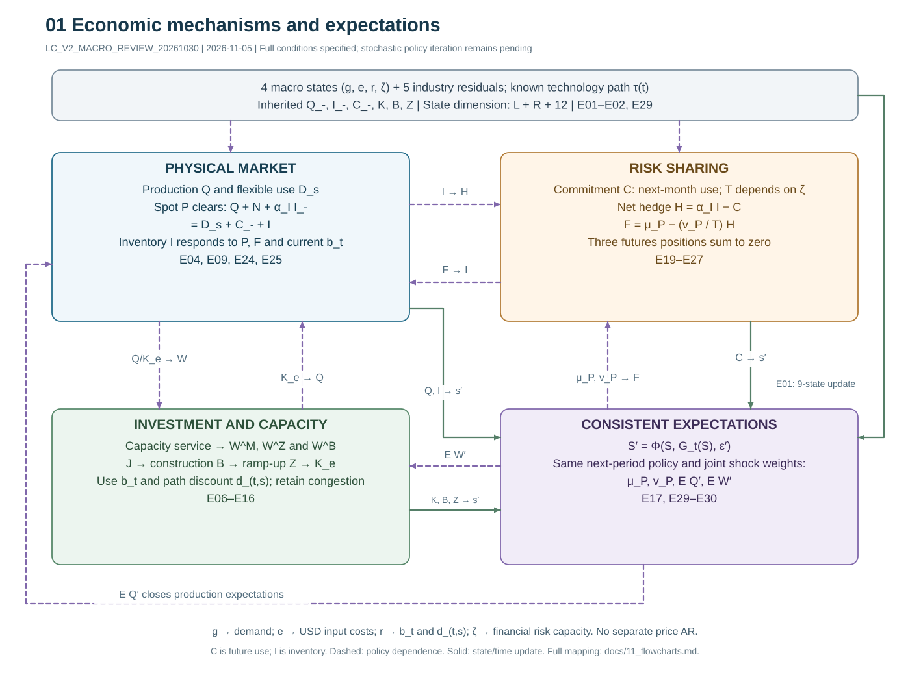

# 02｜主体、时点与定价主线

版本：LC_V2_MACRO_REVIEW_20261030；修订：ALL_CONDITIONS_CLOSURE_20261105。10月30日材料已有的宏观、产业和期货扩展统一保留，完整条件见 [规范方程](03_equations.md) 与 [全条件闭合](14_complete_conditions.md)。

## 谁决定什么

| 主体 | 本期选择 | 已有风险或约束 | 方程 |
|---|---|---|---|
| 锂盐生产者 | 生产Q、新能力启动J | 上期产量、有效能力、建设/爬坡、在建拥挤、变动折现 | E06—E16 |
| 当期灵活材料使用者 | 实际耗用D^s | 当前价格、订单净收益 | E03—E05 |
| 提前排产的材料使用者 | 下期耗用承诺C、期货多空头h^D | 下期原料价格风险 | E20、E22、E23 |
| 库存/贸易中介 | 期末留货I、头寸h^I | 库存损耗、持货服务和价格风险 | E18、E19、E22、E24 |
| 金融投资者 | 头寸h^f | 有限风险承受能力 | E21、E22 |

材料主体按调整时点分组，不是两份完整总需求；omega的数值必须有数据依据。h>0是净多头，h<0是净空头。

## 宏观环境怎样进入主体条件

四个宏观状态为景气g、人民币汇率对数偏离e、月度利率偏离r、风险压力ζ；另有五个行业余项z^id。宏观过程在行业部分均衡外生，并非第五个交易主体。

| 输入 | 直接映射 | 进入的条件 |
|---|---|---|
| g与确定技术路径τ(t) | 需求尺度A及两组收益曲线 | 灵活耗用E04、采购E23 |
| e与行业成本余项 | 仅把美元计价投入换成人民币，形成m | 生产E06/E09、能力服务E13 |
| r | 当前b_t及随机路径积d_(t,s) | 生产E09、价值/投资E14—E16、库存E24 |
| ζ与行业风险余项 | 金融风险厌恶a_f及总风险容量T | 金融FOC E21/E22、清算E27 |
| 五个行业余项 | 需求、可变成本、投资价、净进口、风险容量 | E02及相应主体条件 |

行业余项转移和联合创新核属于模型原始输入；所有续期量共享这一核。τ(t)为已知确定路径，美元投入价未另设独立随机状态，具体闭合选择见E01/E02。当前随机状态维数为4+5+3+1+(L−1)+R＝L+R+12。

## 三张流程图入口

完整中文图、箭头图例及逐项方程映射见 [经济机制、月度时序与求解验收流程图](11_flowcharts.md)。三张图分别说明经济关系、事件时点和计算步骤，避免把不同类型的箭头混在一张总图中。

| 图 | 说明 | 可编辑源码 | 矢量导出 |
|---|---|---|---|
| 经济机制 | 实物清算、风险分担、能力投资与同一政策预期闭环 | [中文 Mermaid](figures/01_mechanism.mmd) | [SVG](figures/01_mechanism.svg) |
| 月度时序 | 继承状态、既有承诺、本期同时决策、队列推进和下一期兑现 | [中文 Mermaid](figures/02_monthly_timing.mmd) | [SVG](figures/02_monthly_timing.svg) |
| 求解与验收 | 完整条件评估、外层政策迭代、边界/终值与后续识别门槛 | [中文 Mermaid](figures/03_solution_workflow.mmd) | [SVG](figures/03_solution_workflow.svg) |

SVG 使用英文短标和方程编号；中文标签与完整解释见上述流程图文档。**现货价格 P、期货价格 F 和各主体的当期选择同时联立清算。** 图中箭头表示物量约束、定价信息或时间更新，不表示先外给一个价格再决定另一个。市场框不是新增主体；期货头寸不创造碳酸锂；新采购承诺 C 也不等于实物库存 I。

## 每月时间线

1. 进入t：继承Q_(t−1)、I_(t−1)、C_(t−1)、成熟能力、建设及爬坡队列；本期x_t和z_t^id已观察，由此计算需求、成本、净进口、风险容量和b_t。
2. 旧一期合约按本期匹配商品价格结算；上期采购承诺在本期耗用。旧合约与数量已定，结算价格P_t仍由本期联立均衡决定。收益归退出者或外部所有者，新进入风险资本不依赖旧财富。
3. 给定共同信息及同一政策生成的未来价格、数量和价值分布，各主体同时选择Q_t、J_t、D_t^s、C_t、I_t和三类持仓，两市场联立清算。当前b_t在t已知，多期折现d保留在未来期望内部。
4. 进入t+1：实现宏观及行业新创新；能力队列推进；本期Q、I、C分别成为下期历史/承诺。F_t是t报价、t+1到期，不是下一期刚开出的F_(t+1)。J首次在t+L可用，L＝1/R＝0的空队列边界按E10—E12执行。

## 相互连接的三条路径

产业路径：订单/成本→生产、使用与留货→现货清算→未来能力价值→投资/建设/爬坡→未来供给。

风险路径：库存与采购敞口→三类持仓→期货清算/风险溢价→留货与新排产→当期及下一期实物清算。

宏观路径：景气/汇率/利率/风险压力→需求、成本、折现、风险容量→上述产业与风险路径；全部未来状态再经同一政策形成一致预期。因果冲击解释另需宏观过程识别。

这些路径不预设库存增减方向，也不等于期货拥有私人信息。共同消息可同时移动两价格，不能把相关性、点价合同使用率或成交量解释成信息主导。

完整未知政策为七个当期实物/价格量加L+R个能力/项目价值。原始条件与价值递推可由 [完整评估器](../model/full_conditions.py) 重算；[条件市场内层](../model/conditional_market.py) 只覆盖其中部分。全随机政策固定点须在这些相同条件下求解，流程图不代表外层求解已经完成。

