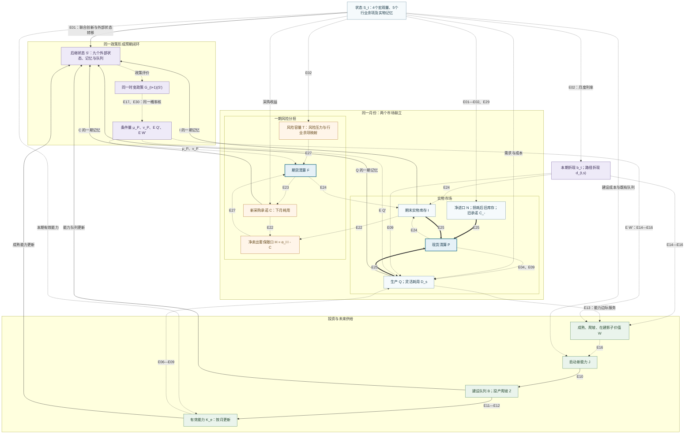
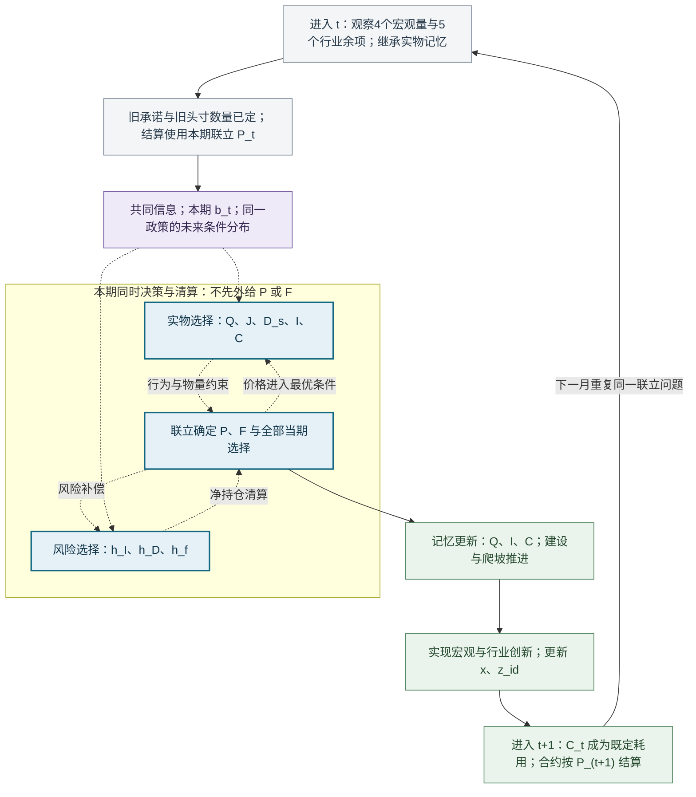
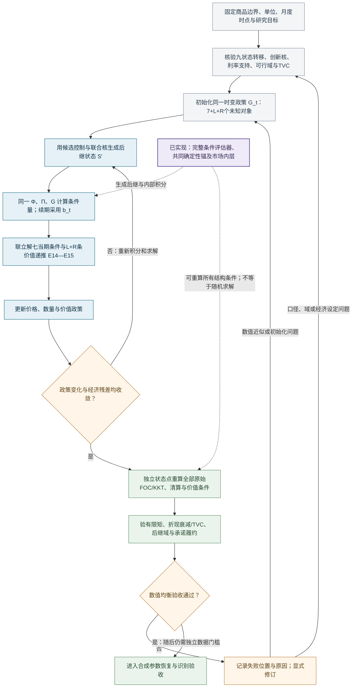

# 11｜经济机制、月度时序与求解验收流程图

版本：LC_V2_MACRO_REVIEW_20261030；修订：ALL_CONDITIONS_CLOSURE_20261105；图稿日期：2026-11-05。规范方程见 [E01—E31](03_equations.md)，7+L+R个政策条件与数学边界见 [全条件闭合](14_complete_conditions.md)。四宏观加五行业余项构成九个外部状态，总随机状态维数为L+R+12。

**图1和图2表达已有扩展的统一经济结构。图3保留 2026-11-05 的求解流程及当时代码覆盖范围。** 最新的随机政策实现和合成基准验收见[随机均衡求解记录](16_stochastic_solution.md)。图中的经济关系对应规范方程。

## 使用与图例

三张图保留可编辑Mermaid源码：[经济机制](figures/01_mechanism.mmd)、[月度时序](figures/02_monthly_timing.mmd)、[求解验收](figures/03_solution_workflow.mmd)。矢量摘要导出：[经济机制SVG](figures/01_mechanism.svg)、[月度时序SVG](figures/02_monthly_timing.svg)、[求解验收SVG](figures/03_solution_workflow.svg)。

SVG使用英文短标与方程编号，由原生矢量元素绘制；它们概括下列中文Mermaid的同一结构，不是Mermaid自动排版的逐节点复制。完整中文标签和关键箭头解释以本页与mmd文件为准。

- 图1粗实线表示数量进入同口径实物清算约束，正负方向由E25决定，不表示新增产量。
- 图1、图2虚线表示价格、风险敞口、政策评价或行为条件的依赖，不表示碳酸锂物量。
- 图1、图2细实线表示跨期记忆、建设/爬坡或月度事件更新；建设箭头跨越多个模型月份。
- 图3实线表示计算与验收顺序，回路要求重新计算；虚线仅标明代码覆盖范围。
- C是下期耗用承诺，I是实物库存；C_−在本期耗用，只记一次。金融头寸没有通向物量账的粗实线。
- μ_P和v_P分别为条件均值和方差，不同于生产约束乘子；Q′、W′、S′均为下期对象。
- b_t在t已知；d_(t,s)是未来利率路径的乘积，保留在多期期望内部。τ(t)给定，政策一般写G_t。

## 图1｜经济机制与理性预期闭环

现货、期货及主体选择组成同一均衡系统。库存既进入物量清算，又影响净套保敞口；期货价格进入留货和新采购安排，新采购仅在下一月成为实际耗用。宏观环境通过需求、成本、折现和风险容量进入这些既有条件。

### 关键箭头与方程对应

| 起点 → 终点 | 经济含义 | 方程及边界 |
|---|---|---|
| 期初状态 → 外部量、主体选择 | 观察4个宏观量和5个行业余项，继承实物记忆 | E01—E02、E29；L+R+12维，不另设价格AR |
| 景气/汇率/风险压力 → 需求/成本/风险容量 | g改变需求，e仅换算美元投入，ζ改变a_f | E02、E04、E09、E21—E27；τ(t)给定 |
| 利率 → b_t/d → 生产、库存、项目价值 | 当前已知折现进入一期续期，路径积进入多期投资 | E02、E09、E14—E16、E24；不能用平均利率的幂替代随机路径 |
| Q、D_s、N、I_−、C_−、I → 现货清算 | 同品级物量约束 | E25：Q+N+α_I I_−＝D_s+C_−+I |
| P → 生产与灵活耗用 | 生产有界最优与需求FOC | E04、E09；保留Q＝0和Q＝K^e边界 |
| P/F → 库存 | 当前购买成本与套保后持货收益比较 | E19、E22、E24；零库存用互补，不强制内点 |
| F → 新采购承诺 | 联合数量/持仓最优给出B_c′＝F | E20、E22、E23；C不是库存 |
| I/C → 净套保敞口H | 损耗后库存形成卖出敞口，承诺形成采购敞口 | E22：H＝α_I I−C |
| H/T/μ/v → F | 风险分担与净持仓清算 | E22、E26约化为E27；两种表示不重复计数 |
| 生产/产能约束 → 能力价值 | 负荷成本节约加稀缺价值 | E13；产量记忆包络E08、能力与项目包络E14—E15 |
| W → J | 当前和未来拥挤成本与完成价值比较 | E16；未来拥挤项不能省略 |
| J → B → Z → K^e → 未来生产 | 开工延迟形成有效供给 | E10—E12；首次可用在t+L，全部L/R边界显式处理 |
| Q/I/C/队列/新创新 → S′ | 一期记忆与物理状态更新 | E01、E10—E12、E29—E30 |
| S′ → G_(t+1) → 条件量 → 当前选择 | 同一政策、转移与核闭合全部预期 | E17、E30；控制变化后重算μ、v、EQ′、EW′ |

价格接受者面对给定价格政策与总量转移；个体选择偏离只改变自身状态。总体投资影响未来供给与均衡价格，不意味着个体FOC还应加入其对市场价格的全导数。风险溢价μ−F与当期基差F−P也分别定义。

## 图2｜月度事件与同时清算

旧头寸和旧承诺的数量在期初已定，但结算使用的P_t仍是本期联立价格。旧收益归退出者或外部所有者，新风险资本不依赖旧财富且没有保证金融资约束，因此旧结算不增加财富状态；期货支付零和本身不足以推出这一结果。

### 月度更新与方程对应

| 阶段或箭头 | 对应关系 | 时点解释 |
|---|---|---|
| 进入t → 继承状态 | E01—E02、E29 | 观察x/z并计算b_t，继承Q/I/C记忆及能力队列 |
| 旧承诺 → 本期耗用 | E05、E25 | C_(t−1)只计一次，不与新C或库存混加 |
| 旧合约 → 本期结算 | E26 | 上期头寸支付h_(t−1)(P_t−F_(t−1))；本轮无财富反馈 |
| 共同信息 → 同时决策 | E09、E14—E17、E19—E21、E30 | 生产/价值预期与风险条件矩共享同一G、Φ、Π |
| 实物/风险选择 ↔ 两市场清算 | E04、E09、E16、E22—E27 | P/F和当前选择同时联立，不能先外给其中一个价格 |
| 本期选择 → 记忆与队列 | E10—E12、E29—E30 | L≥2时J入B；L＝1直接完成；R＝0无Z；新完成量不先折旧 |
| 新创新 → 下月状态 | E01、E30 | 4个宏观量与5个行业余项按同一联合核更新 |
| 进入t+1 → 兑现与重复 | E05、E26、E29 | C_t成为下月耗用；F_t在下月结算，不是新报价F_(t+1) |

图中队列按月推进，不表示t启动的项目必然于t+1达产。下一月承诺履约还需后继状态可行性；有界创新不会自动保证它。

## 图3｜完整求解与验收流程

紫色提示框对应 [完整条件评估器](../model/full_conditions.py)、[共同确定性锚与接口检查](../scripts/check_full_conditions.py) 和 [条件市场内层](../model/conditional_market.py)。评估器从同一政策回调生成未来状态、价格矩和价值预期，重算全部结构条件；它尚不执行高维随机政策迭代。确定性锚检验完整条件的一致性，随机候选只有在残差和其他门槛通过后才可称为数值均衡。

### 计算箭头、方程与验收含义

| 计算步骤 | 方程/文档依据 | 必须留下的证据 |
|---|---|---|
| 文献/参数 → 初始化 | E01—E08、E18；全条件闭合§§2、5、9—10 | 九状态转移、核/支持、利率域、τ路径、曲率、可行域与TVC |
| 候选控制 → 后继状态 | E01、E10—E12、E29—E30 | 施工/爬坡时点、Q/I/C更新、L＝1/R＝0空队列均一致 |
| 后继状态 → 条件量 | E17、E30；全条件闭合§8 | μ、v、EQ′、EW′来自同一G和权重；当前续期乘b_t |
| 条件量 → 联立互补与价值问题 | E09、E16、E04、E23—E25、E27及E14—E15 | 七当期块加L+R条价值递推；四类控制边界使用KKT |
| 当期解 → 政策更新 → 重新积分 | E13—E17、E30 | 同步更新7+L+R个政策对象，政策变化和经济残差均须小 |
| 收敛 → 独立状态验证 | E09、E16、E19—E26、E14—E15 | 独立于求解缓存重算原始FOC/KKT、持仓净和、物量与价值 |
| 独立验证 → 边界/域验收 | 全条件闭合§§5—6、9—10 | 正价格/能力、目标有限、有限矩、折现衰减/TVC、后继域与履约 |
| 失败 → 定位与修订 | [推进门槛](07_roadmap.md) | 报告失败状态和原因，经济条件改变须显式说明；不能裁剪伪造均衡 |
| 数值通过 → 合成识别 | [数据与识别](06_data.md) | 参数组合、独立观测、宏观尺度和测量误差检查；真实数据另验收 |

图中的条件市场内层只冻结当期Q与未来价格矩。外层每次改变控制，都须重新生成后继状态及条件矩，不能把内层输入改成独立价格预测。均衡门槛尚未全部通过；具体已运行检查与误差以 [验证记录](09_validation.md) 为准。

方程计数、图稿生成、市场子块唯一性或有限次仿真成功，都不能证明整体全局存在唯一。无风险一阶近似可能消去风险溢价，须另验保留风险的近似或非线性解。

## 图稿检查范围

三张图采用自上而下分层，无HTML标签或配置指令。内嵌Mermaid与独立源码一致，箭头映射到E01—E31及全条件闭合，没有新增经济约束。九外部状态、b_t/d、7+L+R条件和当前代码范围同步。

检查覆盖源码/内嵌一致性、节点/边引用、子图配对、相对链接及SVG XML。三个SVG已生成栅格预览并检查文字、箭头与边界。当前环境未使用专用Mermaid渲染器，Mermaid完成的是结构检查；图稿检查不等于经济均衡验收。
