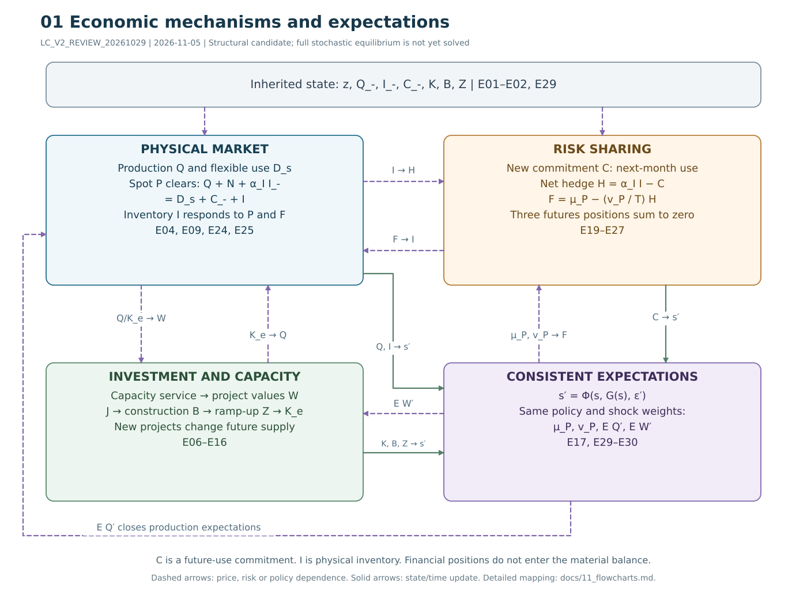

# 02｜主体、时点与定价主线

## 谁决定什么

| 主体 | 本期选择 | 已有风险或约束 | 方程 |
|---|---|---|---|
| 锂盐生产者 | 生产Q、新能力启动J | 上期产量、有效能力、建设时序 | E06—E16 |
| 当期灵活材料使用者 | 实际耗用D^s | 当前价格、订单净收益 | E03—E05 |
| 提前排产的材料使用者 | 下期耗用承诺C、期货多空头h^D | 下期原料价格风险 | E20、E22、E23 |
| 库存/贸易中介 | 期末留货I、头寸h^I | 库存损耗、持货服务和价格风险 | E18、E19、E22、E24 |
| 金融投资者 | 头寸h^f | 有限风险承受能力 | E21、E22 |

材料主体按调整时点分组，不是两份完整总需求；omega的数值必须有数据依据。h>0是净多头，h<0是净空头。

## 三张流程图入口

完整中文图、箭头图例及逐项方程映射见 [经济机制、月度时序与求解验收流程图](11_flowcharts.md)。三张图分别说明经济关系、事件时点和计算步骤，避免把不同类型的箭头混在一张总图中。

| 图 | 说明 | 可编辑源码 | 矢量导出 |
|---|---|---|---|
| 经济机制 | 实物清算、风险分担、能力投资与同一政策预期闭环 | [中文 Mermaid](figures/01_mechanism.mmd) | [SVG](figures/01_mechanism.svg) |
| 月度时序 | 继承状态、既有承诺、本期同时决策、队列推进和下一期兑现 | [中文 Mermaid](figures/02_monthly_timing.mmd) | [SVG](figures/02_monthly_timing.svg) |
| 求解与验收 | 政策迭代、原始残差与可行域检查、失败回退和后续识别门槛 | [中文 Mermaid](figures/03_solution_workflow.mmd) | [SVG](figures/03_solution_workflow.svg) |

SVG 使用英文短标和方程编号；中文标签与完整解释见上述流程图文档。**现货价格 P、期货价格 F 和各主体的当期选择同时联立清算。** 图中箭头表示物量约束、定价信息或时间更新，不表示先外给一个价格再决定另一个。市场框不是新增主体；期货头寸不创造碳酸锂；新采购承诺 C 也不等于实物库存 I。

## 每月时间线

1. 进入t：继承Q_(t−1)、I_(t−1)、C_(t−1)、成熟能力、建设及爬坡队列；本期外部状态已观察。
2. 旧一期合约按本期匹配商品价格结算；上期采购承诺在本期耗用。旧头寸结算是进入者的既定财富项，在无财富效应的基线中不另成为状态。
3. 给定共同信息与一致的未来价格分布，各主体同时选择Q_t、J_t、D_t^s、C_t、I_t和三类持仓，两市场联立清算。
4. 进入t+1：实现新冲击；能力队列推进；本期Q、I、C分别成为下期历史/承诺。F_t是t报价、t+1到期，不是下一期刚开出的F_(t+1)。

## 两条必须讲清的路径

产业路径：订单/成本→生产、使用与留货→现货清算→未来能力价值→投资/建设/爬坡→未来供给。

风险路径：库存与采购敞口→三类持仓→期货清算/风险溢价→留货与新排产→当期及下一期实物清算。

第一个路径不预设库存增减方向；第二个路径不等于期货拥有私人信息。共同消息可同时移动两价格，不能把相关性、点价合同使用率或成交量解释成信息主导。

