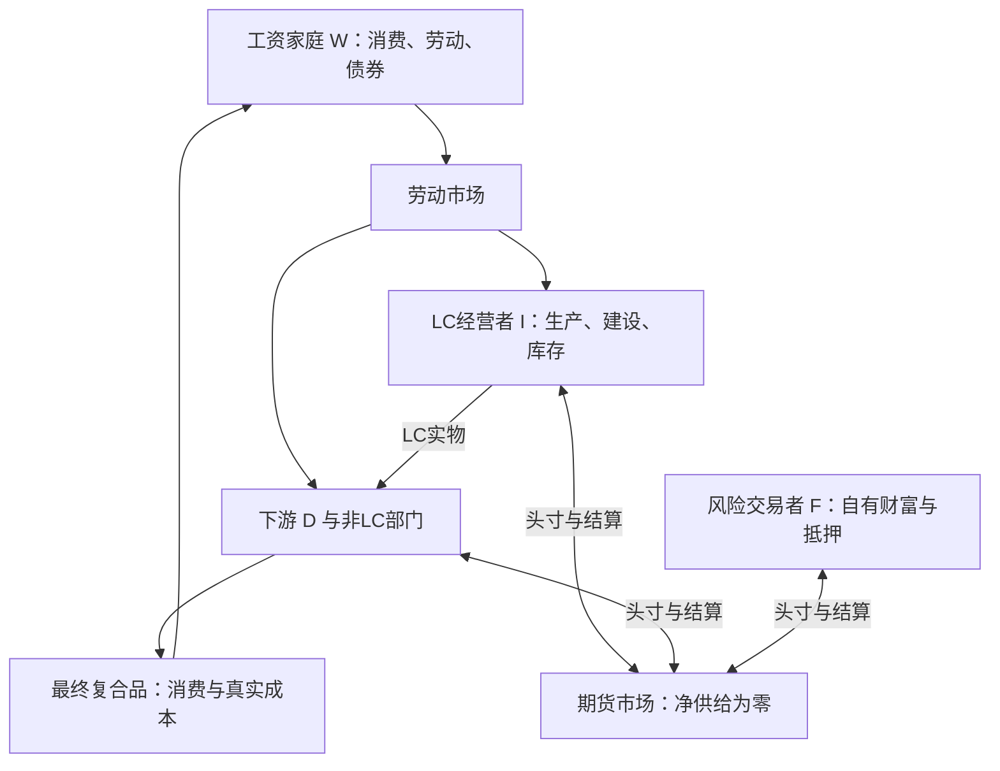

# 03｜从最新LC模型建设完整DSGE：主体、预算与闭合方程

候选编号：`LC_DSGE_DESIGN_20261126`。状态：**可核查的设计蓝图；尚未写成完整求解器，未证明存在唯一均衡，未校准或估计。** G01—G26是设计模块编号，不是已通过独立性检查的标量方程数。

主要结构参考为组内生猪稿[HOG-REF]；逐页映射见[文献对齐](02_group_paper_alignment.md)。下面的家庭类型、企业所有权、最终品组合、抵押约束和LC技术是本项目提出的适配，不冒充生猪稿或其他文献的原式。

| 组内稿位置 | 本蓝图的具体落实 |
|---|---|
| 第7—8页，家庭式(1)—(5) | G03—G05：所有者效用、随机SDF与四份预算 |
| 第8—9页，生产和供给动态 | G10—G15：LC技术、建设、爬坡与投资价值 |
| 第9—10页，需求与期货 | G06—G09、G20—G22：派生需求、预定采购、风险预算与定价 |
| 第11页起，状态空间与实证 | G23—G26：结构创新、财富状态、同政策预期与观测 |

## 1. 首选结构与研究问题

研究问题改写为：**终端需求结构、LC成本和有限风险承担的随机变化，怎样经由建设爬坡、库存、预定采购和期货交易，影响现货、期货、实物产出及消费？**

首选一个真实经济、两类最终部门加LC中间品、四类家庭所有者、不完全资产市场的DSGE。组内稿的“家庭—生产—需求—金融—清算—冲击—观测”顺序保留；生猪直接消费关系改成LC中间投入关系。一个代表家庭的无摩擦版本可以作为嵌套诊断，但不能承载仍由外部重置的三类均值—方差主体。

| 主体 | 所有权与选择 | 风险和资产权限 |
|---|---|---|
| W：工资家庭 | 最终消费、劳动、债券 | 不直接交易期货；可按借款下界交易安全债券 |
| I：LC经营者家庭 | 持有不可交易的生产、建设和库存企业；决定消费、Q/J/I及债券和期货 | 承担企业全部经营与价格风险；无无限制外部股权注资 |
| D：下游经营者家庭 | 持有不可交易的LC密集型最终部门；决定劳动、灵活耗用、下期计划采购、消费与资产 | 未来采购及产品收入风险均进入消费和套保 |
| F：专业风险交易者家庭 | 消费、自有安全资产、期货头寸 | 不借款、不自由发行股本；以自己的安全资产支持抵押要求 |
| 非LC部门与最终组合器 | 竞争、规模报酬不变、零利润 | 提供另一类最终产品及最终复合品，不新增风险家庭 |

四类是有限类型的同质群体，按类型总量计量；每个群体内部的个体价格接受。个体偏离不对市场价格政策求导，汇总后才施加市场清算。这里I合并了上游与库存所有权，是为降低首版维数作出的**新设定**，不是旧PE原封不动搬迁；若论文问题必须区分生产商和贸易商，后续拆成两类经营者，分别列预算和SDF。

不允许W通过无限可增发企业股权间接绕过期货限制。家庭之间只有明确列出的债券和期货交易，没有无条件互保、无成本注资或可交易企业股权。H90表明，一般均衡中的参与和所有权安排会改变套保压力结论；HK13支持资本约束能够改变边际风险承担这一原则，但下述离散时间模型并非其连续时间模型的复制。

图只概括实物流与风险分担。四类家庭都消费最终品，所有预算和债券清算以下文为准；不把示意箭头当作额外经济方程。

## 2. 计价与期内时序

### G01｜真实计价与合约

最终复合品价格归一为1。P、F、工资和成本均以该复合品计价；LC数量按统一吨数/每月流量处理。家庭消费用小写 $c_t^j$，下期采购承诺用大写 $C_t$，不得混淆。

设 $\mathcal R_t$ 为t到t+1的安全总回报，避免与爬坡月数R同符号。$b_t^j$ 是t到期的债券面值，购买 $b_{t+1}^j$ 支出 $b_{t+1}^j/\mathcal R_t$。负债券表示借款。

一期模型合约初始净支付为零，t持仓为 $h_t^j$，到t+1的支付为 $h_t^j(P_{t+1}-F_t)$。当期旧合约结算为

$$
\Xi_t^j=h_{t-1}^j(P_t-F_{t-1}).
$$

这是期末净结算的模型合约。真实交易所的每日盯市、保证金和多到期日另需观测及制度桥；加入下述抵押约束并不等于已经复制每日结算制度。

### G02｜信息与决策顺序

进入t时继承 $Q_{t-1},I_{t-1},C_{t-1},K_t^M,B_t,Z_t,b_t^j,h_{t-1}^j,F_{t-1}$。当期基本面创新实现。现货、产销、工资、旧合约支付、当期消费、新资产、库存、开工与采购计划在同一个当期均衡中联立决定。t+1创新尚未揭示。

旧采购 $C_{t-1}$ 本期实际投入并按 $P_t$ 支付；$C_t$ 是下期必须投入的生产安排，不是本期已购货库存或预付款。如果改成预付款、违约可撤销订单或固定采购价合同，必须同时改付款、交付和套保条件。

## 3. 家庭与逐主体预算

### G03｜效用和所有者SDF

对 $j\in\{W,I,D,F\}$，令

$$
\max E_0\sum_{t\ge0}\beta_j^t
\left[\frac{(c_t^j)^{1-\gamma_j}-1}{1-\gamma_j}
-\mathbf1_{\{j=W\}}\frac{\chi_N(N_t^W)^{1+\nu_N}}{1+\nu_N}\right].
$$

$c_t^j>0$，$\gamma_j>0$，$\gamma_j=1$ 取对数极限。$0<\beta_j<1$。初步确定性锚可采用共同beta，以免所有类型都内点持债的稳态条件互相冲突；不同beta的长期财富分布须单独研究，不能随意设值。

$$
M_{t,t+1}^j=\beta_j\frac{u'_j(c_{t+1}^j)}{u'_j(c_t^j)}
=\beta_j(c_{t+1}^j/c_t^j)^{-\gamma_j}.
$$

不同所有者的M一般不同。企业由其所有者评价，而不是在原外生折现b上再额外叠一个共同家庭Euler。组内稿的家庭思想在此实质接入企业和金融预算。

### G04｜劳动与债券最优条件

W内点劳动选择满足

$$
w_t=\chi_N(N_t^W)^{\nu_N}(c_t^W)^{\gamma_W}.
$$

对W/I/D，首版候选使用明确的有限借款下界 $b_{t+1}^j\ge\underline b_j$，并对可达后继的正消费和偿付另作可行域审查。令债券约束乘子除以当期边际效用为 $\eta_t^j$：

$$
\frac1{\mathcal R_t}=E_tM_{t,t+1}^j+\eta_t^j,
\qquad 0\le b_{t+1}^j-\underline b_j\perp\eta_t^j\ge0.
$$

$1=E_t[M^j\mathcal R_t]$ 只在该债券约束不绑定时成立。F的债券同时支持抵押，其条件见G21。利率由债券清算决定，不再同时强加旧利率AR。

### G05｜四份预算

定义 $\mathcal C_t^Q$ 为LC生产消耗的最终品，不含单列工资；$\mathcal C_t^J$ 为开工实际资源；$g(I_t)\ge0$ 为真实仓储成本；$\mathcal A(C_t,C_{t-1})\ge0$ 为提前生产计划的调整成本；$p_t^B Y_t^B$ 是下游产品销售收入。

$$
c_t^W+\frac{b_{t+1}^W}{\mathcal R_t}=w_tN_t^W+b_t^W.
$$

$$
\begin{aligned}
c_t^I+\frac{b_{t+1}^I}{\mathcal R_t}+w_tN_t^I
+\mathcal C_t^Q+\mathcal C_t^J+g(I_t)
=P_t(Q_t+\alpha_I I_{t-1}-I_t)+b_t^I+\Xi_t^I.
\end{aligned}
$$

$$
\begin{aligned}
c_t^D+\frac{b_{t+1}^D}{\mathcal R_t}+w_tN_t^D
+P_t(D_t^s+C_{t-1})+\mathcal A(C_t,C_{t-1})
=p_t^B Y_t^B+b_t^D+\Xi_t^D.
\end{aligned}
$$

$$
c_t^F+\frac{b_{t+1}^F}{\mathcal R_t}=b_t^F+\Xi_t^F.
$$

I和D的企业与家庭在所有者预算中合并：不再把同一利润分红、投资支出或企业价值重复计入另一份家庭账。非LC部门和最终组合器因竞争且规模报酬不变利润为零；若后续加入固定要素/垄断利润，就必须补其明确所有者。

F是自有财富交易者而非存款银行。其初始正财富由初始资产分配给定，同时其他主体承担对应负债，合计为零；之后只靠收益与消费演化。正稳态财富、持久经营及可达域尚待验证，不能假设每期亏损后自动复位。

## 4. 最终需求必须进入同一个经济

### G06｜非LC部门和最终组合器

为避免把整个经济的最终生产都设为必须使用LC，加入

$$
Y_t^0=A_t^0N_t^0,\qquad w_t=p_t^0A_t^0.
$$

竞争性最终组合器为

$$
Y_t=\left[(1-\omega_t)^{1/\epsilon}(Y_t^0)^{(\epsilon-1)/\epsilon}
+\omega_t^{1/\epsilon}(Y_t^B)^{(\epsilon-1)/\epsilon}\right]^{\epsilon/(\epsilon-1)},
$$

$0<\omega_t<1$，$\epsilon>0$，$\epsilon\ne1$；等于1时另写Cobb–Douglas极限。相应部门需求和价格指数为

$$
Y_t^0=(1-\omega_t)(p_t^0)^{-\epsilon}Y_t,\qquad
Y_t^B=\omega_t(p_t^B)^{-\epsilon}Y_t,
$$

$$
1=\left[(1-\omega_t)(p_t^0)^{1-\epsilon}
+\omega_t(p_t^B)^{1-\epsilon}\right]^{1/(1-\epsilon)}.
$$

零利润恒等式 $p_t^0Y_t^0+p_t^BY_t^B=Y_t$ 是重要核验量，不与等价条件重复计数。omega创新在本候选中改变最终组合的LC密集型产品权重；它不是不受家庭预算约束的“收入冲击”。该参数在组合器中具有技术/组合含义，不能不加说明同时解释为家庭纯偏好冲击。

### G07｜保留灵活耗用与提前排产

给一个可微、可闭合的首版技术候选：

$$
Y_t^B=A_t^B(\bar H_D)^\varphi(N_t^D)^{1-\alpha_s-\alpha_c-\varphi}
(D_t^s)^{\alpha_s}(C_{t-1})^{\alpha_c},
\qquad \alpha_s,\alpha_c,\varphi>0,\quad\alpha_s+\alpha_c+\varphi<1.
$$

两种LC投入对应不同生产环节：一部分当期可调整，一部分需要提前安排；互补性是本项目新增的生产组织假设，不是把同一吨LC在两项中重复使用。实际耗用仍是 $D_t^s+C_{t-1}$。该简洁函数会强制正产出使用两种环节，须以排产事实和敏感性检验支持；不是原稿原式或已经估计的技术。

$\bar H_D>0$ 是由D拥有、不可交易、首版中供给固定的经营组织/专用要素，$\varphi$ 为其份额。它产生经营租金：在无调整成本支出的内点确定性稳态，下游净经营收入为 $\varphi p^B Y^B$。这是为使D的消费具有清楚经营收入来源而加入的本文设定；不是再增加无对手方现金转移。未来若把它解释为可折旧厂房并允许投资，就必须另加资本积累、投资资源与状态，当前状态数也要随之变化。

如果未来改成两类下游工厂，应分别写产出、资本/技术差异和所有权。不能只令 $D=D^s+C_-$，同时允许两者在同成本下完全替代却不给提前采购任何优势，否则C可能退化为零。

### G08｜当期下游选择

在内点、当前采购无额外融资约束时，

$$
P_t=p_t^B\frac{\alpha_sY_t^B}{D_t^s},\qquad
w_t=p_t^B\frac{(1-\alpha_s-\alpha_c-\varphi)Y_t^B}{N_t^D}.
$$

LC需求随最终产品需求、劳动和均衡收入共同变化。旧外给需求尺度与常弹性约化式不能作为另外一组独立需求同时叠加。

### G09｜跨期采购计划

一个可用调整成本是 $\mathcal A(C,C_-)=\kappa_C(C-C_-)^2/2$。正采购计划的最优条件为

$$
\mathcal A_1(C_t,C_{t-1})=
E_t\left[M^D_{t,t+1}
\left(p_{t+1}^B\frac{\alpha_cY_{t+1}^B}{C_t}-P_{t+1}
-\mathcal A_2(C_{t+1},C_t)\right)\right].
$$

未来产品收入、SDF、LC价格和计划调整共同出现。不能继续强制 $C_t=A_t^c(F_t/P_*)^{-\eta_c}$。即使内点期货条件能替换某个 $E[M^DP']$ 项，也不能把未来边际产品的随机协方差丢掉。C=0/停产分支在采用具体技术时需另验，不能把含1/C的内点式用于零承诺。

## 5. LC生产、建设和库存

### G10｜技术与真实成本

首版劳动需求可取 $N_t^I=Q_t/A_t^L$，并保留 $0\le Q_t\le K_t^e$。保留旧工程成本形状，但明确其均为最终品投入且排除工资：

$$
\mathcal C_t^Q=m_tQ_t+\frac{\alpha_Q}{\nu_Q+1}
\frac{Q_t^{\nu_Q+1}}{(K_t^e)^{\nu_Q}}
+\frac{\kappa_Q}{2}(Q_t-Q_{t-1})^2.
$$

$m_t>0,\alpha_Q>0,\nu_Q>0,\kappa_Q\ge0$。本光滑成本表示限定 $K_t^e>0$，并取 $0\le\delta<1$；全部能力退出后的 $(Q,K^e)=(0,0)$ 需要单列停产扩展，不能计算0/0。现实工程成本数据若已含工资，应先拆分再校准，不得在工资和m中重复计入。同样，未来单列进口矿石后要从m中剔除相应项目。

### G11｜产量最优条件

在给定总体价格、所有者SDF和上述成本下，

$$
P_t=\frac{w_t}{A_t^L}+m_t+\alpha_Q(Q_t/K_t^e)^{\nu_Q}
+\kappa_Q(Q_t-Q_{t-1})
-E_t[M^I_{t,t+1}\kappa_Q(Q_{t+1}-Q_t)]
+\lambda_t^K-\mu_t^Q,
$$

$$
0\le Q_t\perp\mu_t^Q\ge0,\qquad
0\le K_t^e-Q_t\perp\lambda_t^K\ge0.
$$

未来调产项必须保留。若修改成本、融资或所有权，还应重新做包络推导；不能机械地用 $E M^I$ 替换旧b后把期望拆开。

### G12｜建设队列

沿用最新PE的“剩余建设期”索引，避免迁移时倒置队列。L为开工到首次可用的月数：

$$
c_t^K=\begin{cases}B_t^{(1)},&L\ge2,\\J_t,&L=1,\end{cases}
\quad B_{t+1}^{(h)}=B_t^{(h+1)}\ (h=1,\ldots,L-2),
\quad B_{t+1}^{(L-1)}=J_t.
$$

L=1时没有B队列。建设不折旧，新增开工在t+L才首次形成可用能力。KP82支持建设时滞与随机均衡并存这一机制，不提供本项目的具体L或爬坡参数。

### G13｜爬坡和成熟能力

R为爬坡月数。R≥1时

$$
Z_{t+1}^{(0)}=c_t^K,\qquad
Z_{t+1}^{(a+1)}=(1-\delta)Z_t^{(a)},\quad a=0,\ldots,R-2,
$$

$$
K_{t+1}^M=(1-\delta)(K_t^M+Z_t^{(R-1)}).
$$

R=0时 $K_{t+1}^M=(1-\delta)K_t^M+c_t^K$，Z为空。

$$
K_t^e=K_t^M+\sum_{a=0}^{R-1}g_aZ_t^{(a)},\qquad
0<g_0\le\cdots\le g_{R-1}\le1.
$$

新完成量在首次投用前不提前折旧。L/R四类边界都要重新在GE状态推进中测试。

### G14｜影子价值与拥挤成本

令 $X_t^B=\sum_hB_t^{(h)}$，

$$
\mathcal C_t^J=p_t^JJ_t+\chi_JJ_t^2/2+\omega_BJ_tX_t^B.
$$

影子价值W定义为I所有者价值函数对个体实物状态的偏导，除以当期消费边际效用，单位为当前最终品。设

$$
v_t^K=\frac{\alpha_Q\nu_Q}{\nu_Q+1}(Q_t/K_t^e)^{\nu_Q+1}+\lambda_t^K.
$$

则在无额外依赖实物状态的融资约束时，

$$
W_t^M=v_t^K+(1-\delta)E_t[M^I_{t,t+1}W_{t+1}^M],
$$

$$
W_t^{Z,a}=g_av_t^K+(1-\delta)E_t[M^I_{t,t+1}W_{t+1}^{Z,a+1}],
\quad W^{Z,R}=W^M.
$$

令U为首次投用价值，R≥1时U=W^{Z,0}，R=0时U=W^M。L≥2时

$$
W_t^{B,1}=-\omega_BJ_t+E_t[M^I_{t,t+1}U_{t+1}],
$$

$$
W_t^{B,h}=-\omega_BJ_t+E_t[M^I_{t,t+1}W_{t+1}^{B,h-1}],\quad h\ge2.
$$

在建状态对未来开工成本的影响不能删除。以上是候选技术下的包络条件；未来若以厂房/库存抵押借款，须补抵押乘子对相应状态的导数。

### G15｜开工选择与终值

$$
0\le J_t\perp p_t^J+\chi_JJ_t+\omega_BX_t^B-\mathcal V_t^J\ge0,
$$

其中 $\mathcal V_t^J=E_t[M^I W_{t+1}^{B,L-1}]$（L≥2），L=1时为 $E_t[M^IU_{t+1}]$。多期展开必须用 $M^I_{t,t+k}=\prod_{s=t}^{t+k-1}M^I_{s,s+1}$ 与未来成本/价值同置于期望，不能替换为均值利率的幂。

G14—G15须结合无泡沫/横截条件和有限价值选择基础解；有限深度尾项很小只是数值诊断，不能当作无限期证明。

### G16｜库存

采用非负、递增的真实仓储成本，例如 $g(I)=h_I I+\chi_I I^2/2$，参数非负；库存存续率 $0<\alpha_I\le1$。无额外库存融资约束时，

$$
0\le I_t\perp P_t+g'(I_t)-\alpha_IE_t[M^I_{t,t+1}P_{t+1}]\ge0.
$$

旧函数 $hI-\xi\log(1+I/I_0)$ 含便利服务，不应整体作为可能为负的真实资源支出。首版将便利服务系数设为0，是明确的受限基线；后续要恢复便利收益，需把服务接到生产、交易技术或偏好，再重推条件，而不是免费增加最终品。DL92支持非负库存与随机理性预期储藏机制，具体g仍是本项目函数选择。

在平稳确定性锚中，若 $\alpha_I\beta_I<1$ 且 $g'\ge0$，库存对偶量为 $(1-\alpha_I\beta_I)P+g'(I)>0$，故该锚必须取I=0。随机经济仍可能在部分状态持有正库存；若要得到正确定性库存，需先建立真实库存服务等额外机制，不能复制旧正库存锚或强行设内点。

## 6. 三本市场账与最终资源账

### G17｜LC实物清算

封闭诊断版本满足

$$
Q_t+\alpha_I I_{t-1}=D_t^s+C_{t-1}+I_t.
$$

金融头寸不进入这条物量账。后续开放经济版本才加入净进口，并同步支付与外部资产账，不能把免费进口硬塞进封闭模型。

### G18｜劳动和最终资源

$$
N_t^W=N_t^I+N_t^D+N_t^0.
$$

四份G05预算相加，利用LC、劳动、债券、旧期货支付清算及组合器零利润，得到

$$
\boxed{Y_t=\sum_{j\in\{W,I,D,F\}}c_t^j
+\mathcal C_t^Q+\mathcal C_t^J+g(I_t)+\mathcal A(C_t,C_{t-1}).}
$$

推导中LC销售与采购支付相消，工资相消，债券净头寸和旧期货结算也相消。非LC部门的 $wN^0=p^0Y^0$ 将其产出接入组合器总资源。不能再把 $P_t(D_s+C_-)$ 作为额外社会资源消耗；它已是中间部门间支付。

这条等式既是闭合的核心，也是未来逐状态的独立会计校验。求解时要处理Walras冗余：通常剔除一条等价市场方程，求解后重新验证全部原始预算与资源式，不能把所有等价式当独立方程硬凑方阵。

### G19｜债券和期货清算

$$
\sum_j b_{t+1}^j=0,\qquad h_t^I+h_t^D+h_t^F=0,\qquad h_t^W=0.
$$

初始债券和旧期货也满足净额为零。期货风险溢价不是资源耗损，保证金名义额不是社会消费；若添加真实经纪服务费，只把实际服务资源成本计入G18。

## 7. 风险资本与新期货定价

### G20｜I与D的套保条件

若其期货头寸内点且无额外头寸约束，

$$
E_t[M^I_{t,t+1}(P_{t+1}-F_t)]=0,
\qquad E_t[M^D_{t,t+1}(P_{t+1}-F_t)]=0.
$$

I、D的消费与未来收入风险随持仓共同调整，因此两式可以与一个市场F相容，并不要求M^I=M^D。经营者借款约束改变消费/SDF；若另加对h的抵押、仓单或限仓，则对应乘子必须进入此式。

### G21｜F的风险资本与抵押约束

F不能借款；制度性抵押候选为

$$
\frac{b_{t+1}^F}{\mathcal R_t}-\kappa_tP_t|h_t^F|\ge0,
\qquad\kappa_t>0.
$$

正P和正安全回报下，该抵押不等式已经蕴含 $b_{t+1}^F\ge0$，不再为同一非负性重复添加独立约束和乘子。抵押资产仍是债券资产，不在预算中再扣一次。F不能无成本发行权益，风险资本来源就是G05预算。令该约束的当期边际效用归一乘子为 $\lambda_t^F\ge0$，则

$$
E_t[M^F_{t,t+1}(P_{t+1}-F_t)]
=\lambda_t^F\kappa_tP_t\,s_t^h,
\quad s_t^h\in\partial|h_t^F|,
$$

$$
\lambda_t^F\left[\frac{b_{t+1}^F}{\mathcal R_t}-\kappa_tP_t|h_t^F|\right]=0.
$$

非零h时 $s_t^h=\operatorname{sgn}(h)$，h=0时使用区间[-1,1]的次梯度，不把sign(0)=0当成唯一经济条件。F债券的一阶条件为

$$
\frac1{\mathcal R_t}=E_tM^F_{t,t+1}
+\frac{\lambda_t^F}{\mathcal R_t}.
$$

等价于 $1=\mathcal R_tE_tM^F+\lambda_t^F$。不能既给抵押资产影子服务，又强加无约束F债券Euler。下一期F仍需正消费和继续经营；$b'=h=0$ 会导致下一期净值为零，在无外部收入的首版中由可行域排除。

### G22｜金融财富与定价分解

$$
N_t^F=b_t^F+h_{t-1}^F(P_t-F_{t-1}),\qquad
N_{t+1}^F=b_{t+1}^F+h_t^F(P_{t+1}-F_t).
$$

每个可达后继都需有正消费和继续经营的偿付域。保证金公式不自动保证极端后继不破产；首版使用有界创新核并验证后继域，不允许负净值后重置。若引入退出/重入，退出财富归属与新资本提供者须双方记账，再新增机制。

对F非零头寸，上式推得

$$
E_tP_{t+1}-F_t=
\frac{\lambda_t^F\kappa_tP_t\operatorname{sgn}(h_t^F)
-\operatorname{Cov}_t(M^F_{t,t+1},P_{t+1})}{E_tM^F_{t,t+1}}.
$$

这是本候选条件下的代数分解，不是引用某篇文献的原式。约束不绑定时退化为SDF协方差定价；约束绑定时加入风险资本的影子楔子。风险压力的效应随净头寸、消费风险和约束区域变化，不能事先宣称其一定提高现货或期货。

旧E27 $F=\mu-v(\alpha_II-C)/\mathcal T$ **不再作为新均衡独立条件**。I现在还承担生产风险，D承担最终产品收入风险，F财富与抵押内生，原净敞口与固定风险容量表达不再一般成立。旧式保留为受限PE对照；若需局部均值—方差近似，应从新效用及资产菜单推导并注明误差阶数。

## 8. 随机环境、状态与观测

### G23｜最小结构冲击组

先采用三个明确原始驱动：终端组合权重 $z^\omega$、LC真实成本 $z^m$、抵押要求 $z^\kappa$。

$$
z_{t+1}=R_z z_t+\Sigma_z\varepsilon_{t+1},\quad
E_t\varepsilon_{t+1}=0,\quad E_t[\varepsilon\varepsilon']=I.
$$

$$
\omega_t=\operatorname{logistic}(\bar a_\omega+z_t^\omega),\quad
m_t=\bar m e^{z_t^m},\quad
\kappa_t=\bar\kappa e^{z_t^\kappa}.
$$

必须另外指定联合概率核和支持，不能只写均值协方差就声称非线性期望已完全定义。首版可用独立有界两点核；实证阶段是否采用相关或非高斯创新需识别依据。此三项是有意缩减的起步驱动，不代表旧九冲击已经估计或已经移入GE。

总景气成为内生总量变化；安全利率由G04/G19决定；金融净值由G22演化。开放经济之后再引入世界利率、外币成本和汇率制度。建设成本、上下游技术及风险波动率可逐一扩展。抵押要求水平创新不是波动率创新；已知技术趋势不是未知创新。

### G24｜状态必须包含风险分配

一个未压缩的候选状态为

$$
S_t=(z_t,Q_{t-1},I_{t-1},C_{t-1},K_t^M,B_t,Z_t,
b_t^W,b_t^I,b_t^D,h_{t-1}^I,h_{t-1}^D,F_{t-1}).
$$

由清算恢复b^F与h^F；政策包括消费、劳动、产销、库存、开工、采购、产品价格、工资、利率、新头寸和全部必要影子值。以上原始表达的状态数为 $n_z+L+R+9$，不是最小状态定理；可研究用已承诺结算账户压缩旧报价和债券，但须证明保留全部预算和抵押信息。

若n_z=3，该数字恰好等于旧L+R+12，也完全不表示沿用了旧状态：旧模型有9个外生驱动，新模型含财富与未结算合同。不能复用旧17维数组而只重命名坐标。

未解的均衡一般形式为

$$
S'=\Phi(S,G(S),\varepsilon'),\qquad
\mathcal F(S,G(S),G(S'),M^j,\text{multipliers})=0
$$

及相应互补条件。所有条件期望、价格均值方差、产品收益、SDF和影子价值都使用同一G、Phi和核。状态转移矩阵只能由解线性化取得，不能另拟一个自由矩阵补空缺。

### G25｜可行性、独立性与终值

必须分别检查正消费、正产品价格、有限效用、非空可行域、债务下界、全部后继偿付、库存/投资/产能/抵押边界和跨期无庞氏/横截条件。无泡沫值与有界折现尾项需要针对新M^j验证；旧常数b的充分条件不能直接继承。

当前没有宣称存在唯一性。下一阶段要在明确借款边界、初始财富和参数域后，对原始预算与KKT确定独立条件，处理Walras恒等式，检查局部雅可比秩及可能的多重稳态。BK80用于合适内点线性系统的局部解与确定性，不证明这个非线性多约束模型全局唯一。

零风险时若一期到期支付恒为零，持仓FOC退化；h=0可作满足清算的初始化约定，不是持仓唯一性结论。不能要求该退化点的全金融系统必然满秩，也不能据此直接应用BK或断言模型错误。应对可识别的实物子系统作局部核验，对完整金融系统使用有限正风险锚/正风险延续或明确的高阶选择，再审查局部秩与解。

### G26｜观测和开放经济接口

行业实证版本须另有明确的边界：国内LC实际耗用、库存统计覆盖、进出口及上游原料支付、最终品部门指标、资产/持仓及融资数据。现货与一期模型F要匹配品级、地点、税费、货币、期限和交割结算定义。

封闭版本只做理论与数值诊断。恢复进口时至少增加进口数量/价格、外部支付和国外资产或外部转移的对手方；采用小型开放经济可保留外生世界条件，但须有国际预算闭合，不能仅把旧N_t加回物量账。若研究政策利率、通胀和名义汇率，则需相容的名义定价和政策制度；不要只附加一条Taylor规则就宣布完成。

混频观测、缺测和测量误差建立在已求出的结构政策上。先做统一月度模型，再讨论日频观测如何对应潜在状态和月内信息；行掩码H_t不能单独完成时间聚合。

## 9. 为什么这是一条可行的DSGE建设路线

动态来自建设、爬坡、库存、采购和资产继承；随机来自决策时未知的结构创新与同一核下的期望；一般均衡来自消费/劳动/企业/资产的联合优化、全体预算、两类最终部门、LC及资产市场清算。风险承担有限，体现在消费效用、非交易所有权、资产参与和可核验的抵押约束。

这套候选已经给出了预算相加的闭合路径，同时公开剩余工作：初始财富、借款边界与后继域、具体参数、独立方程与完整KKT实现、确定性锚、随机求解以及识别。它提供的是可以开始严格实现的设计，而不是对尚不存在的GE求解结果作完成声明。

组内文献继续负责主体顺序、动态产业链、冲击和实证链条的组织；经典文献用于核查建设时滞[KP82]、储藏[DL92]、资产参与[H90]、金融资本[HK13]和高阶随机求解[SGU04，AND11/12]。全部来源及核验层级见[来源登记](../references/README.md)。
