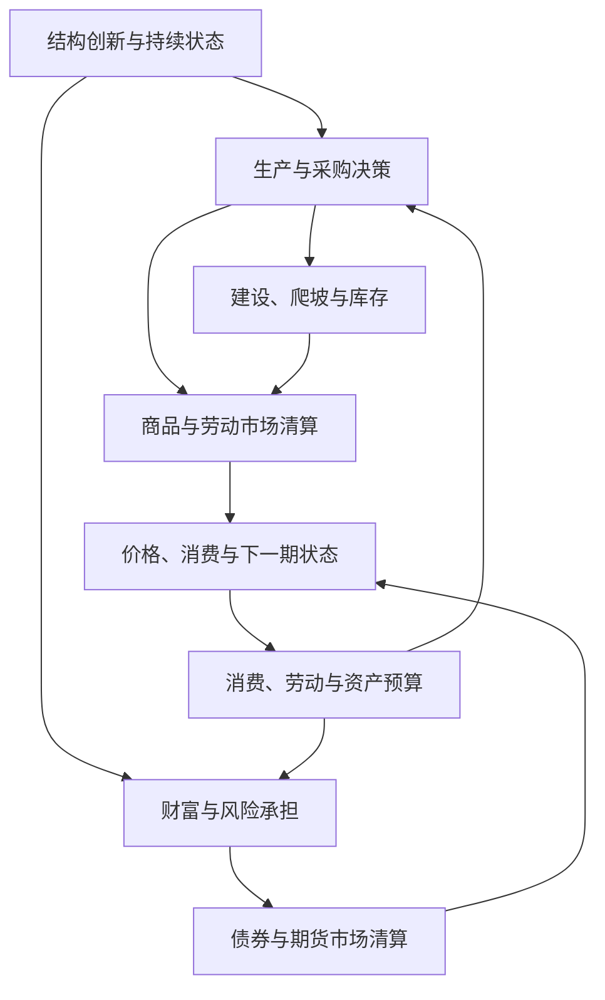

# 03｜继承LC研究的DSGE结构与建模选择

现行模型为 `LC_DSGE_EQCHAIN_20261126`。**完整方程规范是[06｜E01—E40方程链](06_equation_chain.md)**；原31组的逐项迁移见[08](08_legacy_equation_map.md)。本文件说明结构选择，不再维护另一套与实现分叉的G01—G26公式。前一设计蓝图完整保留在Git提交 `f3ff6d6`。

## 1. 继承的研究问题

研究仍围绕：需求、成本和金融风险承担的变化，怎样经过LC生产、建设爬坡、库存、提前采购和期货交易，影响现货与期货价格。组内生猪稿继续提供“家庭—产业供给—需求—期货—冲击—观测”的组织主线；LC原研究提供具体产业动态。新增家庭和资源清算，使原问题在有明确最终风险承担者的经济中得到一致回答。

本轮已完成方程链、原条件审计、合成确定性锚，并进一步求得**零库存且其他约束松弛分支上的局部一阶随机理性预期解**，计算0—36月冲击响应。局部随机解是实际成果；完整非线性正风险政策、约束切换与真实估计仍未通过对应验收，见[09随机计算](09_stochastic_computation.md)。

## 2. 主体与市场

W工资家庭提供劳动、消费并持有债券；I拥有不可交易的LC生产和库存企业；D拥有下游企业及固定经营要素；F用自有资产承担期货风险。I/D/F均消费最终复合品并持有自己的金融头寸。非LC部门和最终组合器竞争且零利润。

图示概括冲击入口和经济反馈；精确时点以E01—E40为准，一个箭头不是额外标量方程。

## 3. 本轮具体假设及其代价

| 选择 | 作用 | 保留的边界 |
|---|---|---|
| I合并生产与库存所有权 | 产业收益进入同一消费预算 | 原独立生产商和库存商风险分配未原样复制 |
| W不交易期货、产权不可交易 | 明确有限风险参与 | 特定市场结构，不是所有GE必须如此 |
| D有固定经营要素 | 为其消费提供经营租金 | 要素份额须依据；资本扩展另加积累与资源 |
| 灵活与预定LC投入互补 | 保留采购时点并说明提前安排的用途 | 暂不覆盖零承诺停产分支 |
| 非负仓储成本、便利服务暂为0 | 资源账明确，保留随机库存选择 | 确定性锚零库存；恢复服务须有真实机制 |
| F自有债券抵押 | 由内生财富和约束表达有限风险承担 | 不是每日盯市的完整复制或旧风险参数改名 |
| 四个结构冲击 | 对应需求构成、生产成本、建设成本和融资紧度 | 尚未识别估计，不是DSGE定义要求 |
| 封闭、真实计价的首版 | 先审计国内预算和资源 | 中国实证须补贸易、外部支付和相应数据 |

## 4. 对原方程最重要的连接

**经营价值连接所有者消费。** 物理队列不变，价值递推由外给折现改为含所有者SDF的条件期望；未来价格、工资、产量和消费风险共同进入决策。

**中间需求连接最终产品。** LC不是家庭直接消费品，旧收益积分不能当最终产出。通过D生产和最终组合器，家庭收入支出影响LC耗用，LC成本反馈最终产品和消费。

**期货风险连接预算和财富。** 净零期货不创造资源，但结算改变不同类型的消费与资产。由持仓最优及抵押条件推导定价，再与清算联立；不硬加旧MV闭式。库存套利的旧形状在规定条件下仍能精确保留，见E24/E28。

## 5. 当前随机解与下一层完成标准

当前局部计算以正开工、零库存和其余约束松弛为分支，删去恒为0的继承库存坐标后有17个状态。广义Schur解满足一阶理性预期条件，最大残差约1.11e-14。零风险期货块秩为1，不能从普通一阶条件选出头寸；本轮另用领先二阶SDF协方差相等条件选择零阶组合，不把它称为完整二阶政策。

四个创新均进入声明的联合核，主结果σ=0.001。当前局部分支中，抵押过程没有非零一阶响应，库存也未进入正值区间。两项结果明确限定了本轮可以展示的机制，不能用任意风险资本重置或固定响应符号补出希望看到的效果。

三个财富方向具有单位根且受创新驱动，所以此局部近似未给出遍历财富分布。完整正风险非线性候选还须在声明域内满足原条件、所有后继可行性、约束切换和尾项；本轮自由斜率投影因动态不稳定及可达后继抵押违规而被拒绝。其配点误差较小不改变这一判断。

实际命令与结果见[04实施记录](04_implementation_plan.md)、[局部随机证据](validation/local_stochastic_20261126.json)和[确定性证据](validation/equation_chain_20261126.json)。新关系式依据见[10近年文献](10_recent_literature.md)及[文献登记](../references/README.md)。
