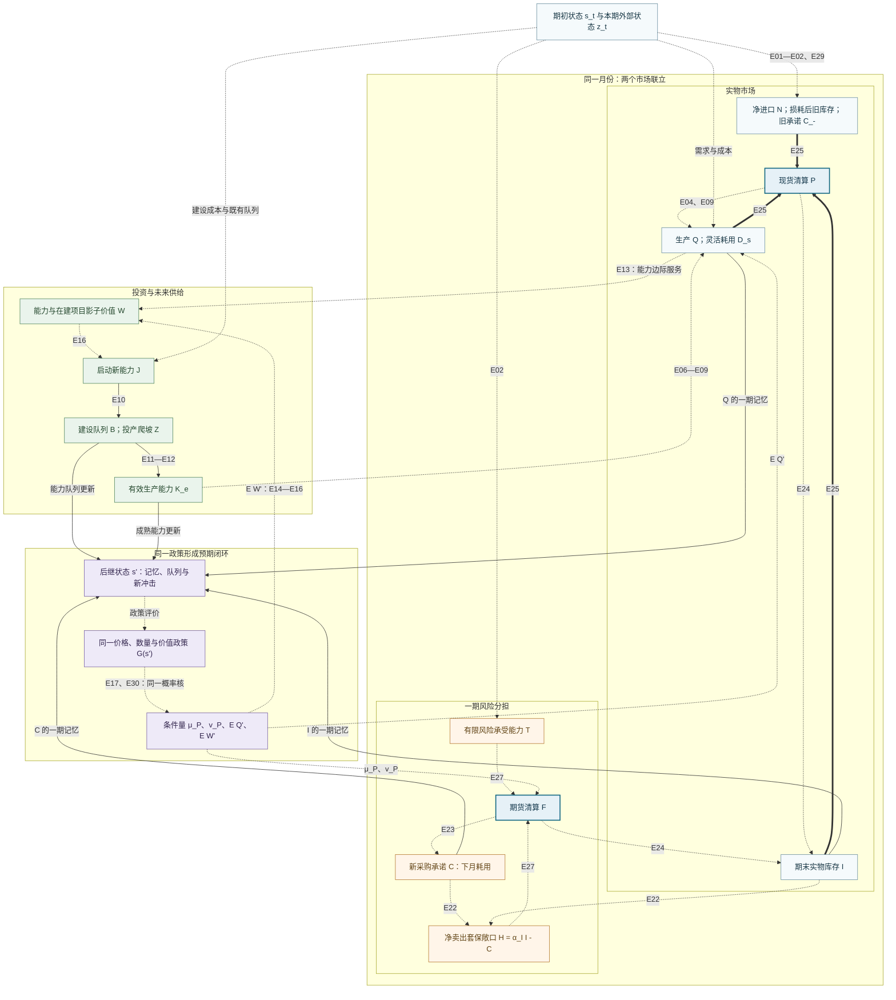
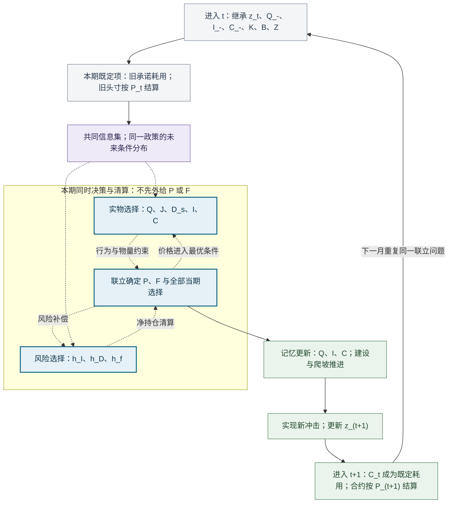
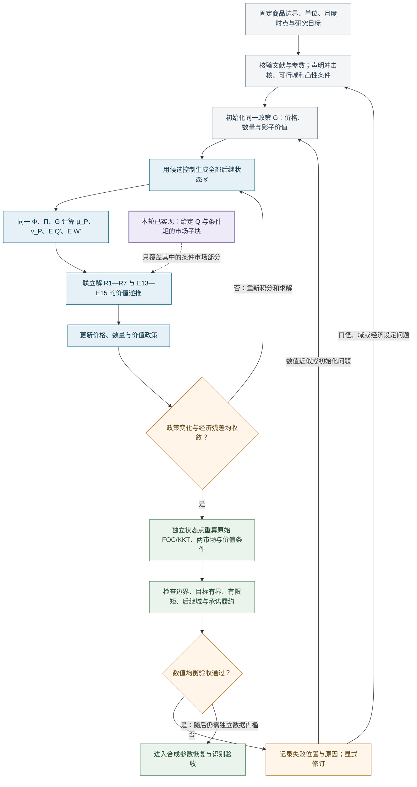

# 11｜经济机制、月度时序与求解验收流程图

版本：`LC_V2_REVIEW_20261029`；图稿日期：2026-11-05。规范方程见 [E01—E31](03_equations.md)，七条件系统与数学边界见 [结构闭合说明](10_closure.md)。

**图1和图2表达候选模型的经济结构；图3表达尚待实现的完整求解流程。本轮已实现的是给定产量与未来条件矩的市场子块，不能将其当作完成整个随机均衡。** 图中的每条关键联系均对应已有方程，没有引入独立价格预测、额外需求或新的履约机制。

## 使用与图例

三张图均保留可编辑 Mermaid 源码：[经济机制](figures/01_mechanism.mmd)、[月度时序](figures/02_monthly_timing.mmd)、[求解验收](figures/03_solution_workflow.mmd)。

同时提供可直接导出的矢量摘要图：[经济机制 SVG](figures/01_mechanism.svg)、[月度时序 SVG](figures/02_monthly_timing.svg)、[求解验收 SVG](figures/03_solution_workflow.svg)。SVG 使用英文短标与方程编号，由原生矢量元素绘制；它们概括下列中文 Mermaid 的同一结构，不是 Mermaid 自动排版的逐节点复制。完整中文标签和关键箭头解释以本页与 `.mmd` 文件为准。

- **图1粗实线**表示数量进入同口径实物清算约束，正负方向由 E25 决定；它不是货物流向或新增产量。
- **图1、图2虚线**表示价格、风险敞口、政策评价或行为条件的依赖，不能当作碳酸锂物量。
- **图1、图2细实线**表示跨期记忆、建设/爬坡或月度事件更新；建设箭头跨越多个模型月份。
- **图3实线**表示计算与验收顺序；回路表示必须重复计算。图3虚线只标明本轮代码覆盖范围。
- 图中的 `C` 是下期耗用承诺，`I` 是实物库存；`C_-` 在本期作为实际耗用进入物量账。金融头寸没有任何通向物量账的粗实线。
- `μ_P` 表示条件均值，`v_P` 表示条件方差；不同于生产约束乘子。带撇号的 `Q'`、`W'` 与 `s'` 均对应下期。

## 图1｜经济机制与理性预期闭环

现货清算、期货清算及主体选择是同一个均衡系统的组成部分。图中两市场之间的回路不表示先求一个外生价格再递推另一个。特别是，库存通过实物清算影响现货，也通过套保敞口影响期货；期货又进入库存和新采购安排。新采购承诺仅在下一月进入实际耗用。

### 关键箭头与方程对应

| 起点 → 终点 | 经济含义 | 对应方程及边界 |
|---|---|---|
| 期初状态 → 外部量、主体选择 | 继承记忆并观察当期订单、成本、净进口与风险环境 | E01—E02、E29；不新增价格 AR 过程 |
| 生产、灵活耗用、净进口、旧库存、旧承诺、新库存 → 现货清算 | 同品级物量约束 | E25；`Q+N+α_I I_-=D_s+C_-+I` |
| 现货价格 → 生产与灵活耗用 | 生产有界最优条件、需求一阶条件 | E04、E09；生产可处于零产量或能力上界 |
| 现货价格、期货价格 → 库存 | 留货的套保收益与持有成本比较 | E19、E22、E24；零库存使用互补条件 |
| 期货价格 → 新采购承诺 | 联合实物和套保选择给出采购条件 | E20、E22、E23；不把 C 当作库存 |
| 库存、新采购承诺 → 净套保敞口 | 损耗后库存形成卖出风险，承诺形成采购风险 | E22；`H=α_I I-C` |
| 净套保敞口、风险承受能力、条件均值/方差 → 期货价格 | 风险分担与持仓净和为零 | E22、E26，约化为 E27；E27替换原持仓块，不重复计数 |
| 生产与能力约束 → 能力价值 | 负荷成本节约与产能稀缺价值 | E13；影子价值的跨期递推见 E14—E15 |
| 能力/在建价值 → 新开工 | 投资收益与启动、调整、拥挤成本比较 | E16；不能让 J 直接增加当期 Q |
| 开工 → 建设 → 爬坡 → 有效能力 → 生产 | 延迟形成未来供给 | E10—E12、E06—E09；L/R 的边界替换沿用规范 |
| Q、I、C、队列与冲击 → 后继状态 | 更新实际记忆与物理能力状态 | E01、E10—E12、E29—E30 |
| 后继状态 → 同一政策 → 条件量 → 当前选择 | 用同一政策、同一转移和概率核闭合全部预期 | E17、E30、E09、E14—E16、E27；不是单独外给 μ 或 v |

生产者面对的价格路径在个体最优问题中为给定，在总体均衡中内生。因此“未来价格/价值影响开工”和“开工影响未来供给与价格”可以同时成立；并不要求个体把自己对市场价格的影响再放进价格接受者的一阶条件。

## 图2｜月度事件与同时清算

旧头寸和旧承诺在期初已确定，但旧合约结算使用的 `P_t` 仍是本期联立均衡价格。图中把它列为“既定项”指既有合约和数量，不指本期价格已经在其他决策之前外生给出。基线没有财富效应，所以旧头寸结算不另增加财富状态。

### 月度更新与方程对应

| 阶段或箭头 | 对应关系 | 时点解释 |
|---|---|---|
| 进入 t → 继承状态 | E29 | 继承 Q、I、C 的一期记忆及建设/爬坡队列 |
| 旧承诺 → 本期实际耗用 | E05、E25 | `C_(t-1)` 只计一次，不与新 C 或库存混加 |
| 旧合约 → 本期结算 | E26及合同支付定义 | 上期头寸收益为 `h_(t-1)(P_t-F_(t-1))`；本轮无财富反馈 |
| 共同信息 → 同时决策 | E17、E19—E21、E30 | 三类风险主体共享同一未来价格条件分布 |
| 实物/持仓选择 ↔ 两市场清算 | E04、E09、E16、E22—E27 | 解同一组联立条件，P与F没有先后外生排序 |
| 本期选择 → 记忆与队列更新 | E10—E12、E29—E30 | 本期 Q、I、C 分别成为下期历史量；J进入建设队列 |
| 冲击实现 → 下月状态 | E01、E30 | 新外部状态与已更新的内生记忆共同决定下一期政策 |
| 进入 t+1 → 兑现与重复 | E05、E26、E29 | C_t成为下月既定耗用，F_t对应下月到期合约，而非 F_(t+1) |

建设和爬坡的具体推进在 E10—E12 中定义；月度流程图不把 `t` 启动的项目画成 `t+1` 必然达产。下一月承诺是否可履行，还必须通过后继状态可行性检查。

## 图3｜完整求解与验收流程

图3是实施规范。完整外层政策固定点、独立状态点验证、参数恢复与真实估计尚待实施。紫色提示框对应 [条件市场子块](../model/conditional_market.py)，其“给定Q和条件矩”只是在内层分析中使用的条件，不得带到外层变成独立价格预测。

### 计算箭头、方程与验收含义

| 计算步骤 | 方程/文档依据 | 必须留下的证据 |
|---|---|---|
| 文献和参数 → 初始化 | E01—E08、E18；闭合说明 §§5、7、9 | 商品与单位、参数来源、冲击核、可行域、投资曲率条件 |
| 候选控制 → 后继状态 | E01、E10—E12、E29—E30 | 施工/爬坡时点与 Q/I/C 记忆更新一致 |
| 后继状态 → 条件量 | E17、E30；闭合说明 §8 | μ、v、EQ′、EW′ 来自同一政策与概率权重；不得自由拟合 |
| 条件量 → 当期互补问题 | 闭合说明 R1—R7；E09、E16、E04、E23—E25、E27 | 零库存、零开工、零产量、能力上界的对应互补状态 |
| 当期解 → 政策更新 → 重新积分 | E13—E17、E30 | 价格、数量与价值同步更新；不能只检查政策变化而忽略原条件 |
| 收敛 → 独立状态验证 | E09、E16、E19—E26、E13—E15 | 独立于求解网格/缓存的原始残差、持仓净和与物量守恒 |
| 独立验证 → 边界/域验收 | 闭合说明 §§5、7、9 | 目标有限、价格与能力为正、有限二阶矩、后继状态域、承诺可履行 |
| 验收失败 → 定位与修订 | [推进门槛](07_roadmap.md) | 报告失败；经济设定若改变则重审，不 clip 数量/价格以伪造均衡 |
| 数值验收通过 → 合成识别 | [数据与识别](06_data.md) | 独立观测与参数组合检查；尚不得跳过数据门槛直接做真实估计 |

不能把方程计数、Mermaid图生成、子块唯一性或有限次仿真成功当成全局存在唯一性证明。若采用无风险一阶近似，应另查风险溢价渠道是否消失；旧版本 Riccati 结果不属于此流程的完成记录。

## 图稿检查范围

三张图使用独立、可编辑的 Mermaid 源文件；本页内嵌源码与独立文件保持一致。图采用自上而下分层，未使用 HTML 标签或配置指令。箭头逐项映射到 E01—E31 和闭合说明，没有新增经济约束。

本轮检查覆盖源文件与内嵌内容一致性、节点和边的引用、子图配对、相对链接与 SVG XML；三个 SVG 已分别生成栅格预览并检查文字、箭头和边界。当前环境没有安装专用 Mermaid 渲染器，因此 Mermaid 只完成结构检查，未声称运行其渲染器通过。图稿检查不等于经济均衡验收。

