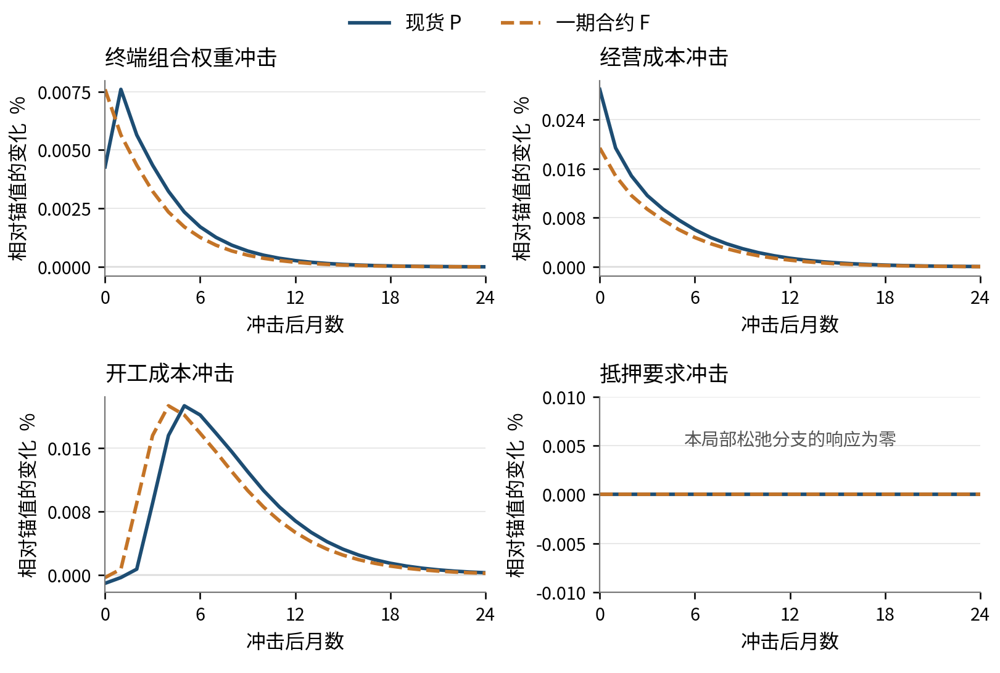
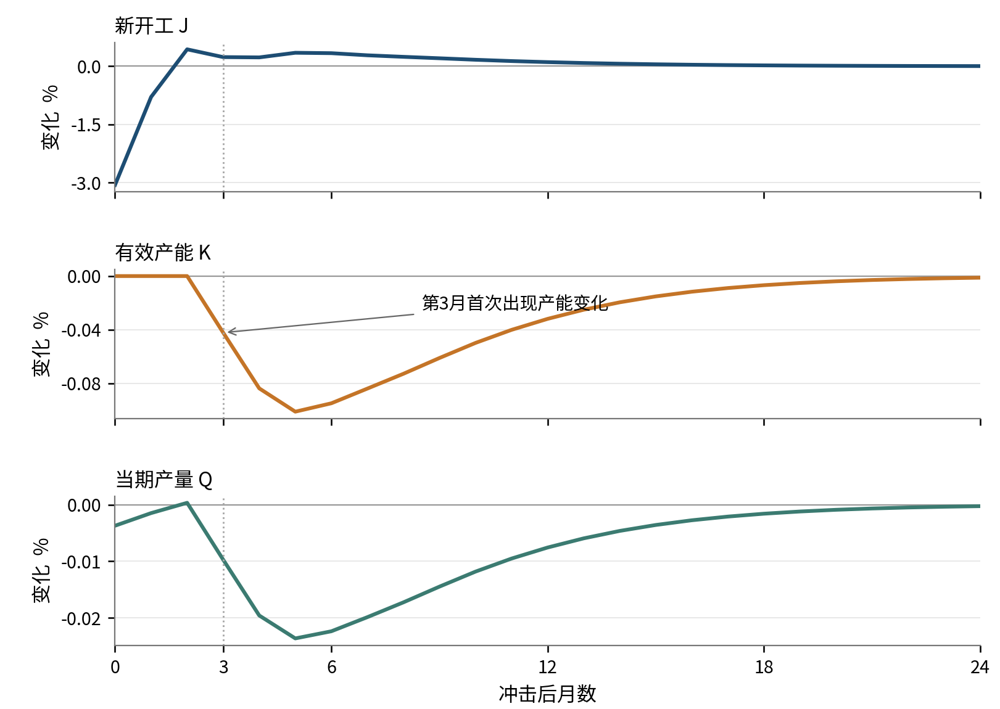

# 11月26日组会汇报

## 碳酸锂DSGE模型的随机冲击与局部求解

### 一、本周主要调整

前几次组会主要整理了碳酸锂的生产、库存、提前采购和期货定价，以及新增项目经过建设和爬坡形成产能的过程。本周围绕中期答辩中提出的随机冲击体现不够清楚的问题，继续检查这些关系：冲击进入哪项经济条件，企业在未来价格尚未实现时怎样决策，以及生产和期货交易的收益最终由谁承担。

原研究已经写有随机状态和条件期望。本周的推进是在原有产业机制上，补充家庭消费、企业所有者预算、劳动与资产市场，并求解由这些条件共同决定的随机动态。主要参考仍为组内生猪论文，沿用“主体选择—冲击过程—市场清算—价格传导”的组织方式；建设时滞、爬坡、库存和预定采购继续按碳酸锂研究的时点处理。

现行方程保留E01至E31的对照编号，另以E32至E40补足家庭、预算和一般均衡条件。保留编号是方便与原研究对照，不表示原式完全不变。需求来源、未来收益评价、期货定价与财富结转，已经按照新的所有权和风险承担方式重新推导。

本周在此基础上得到了一组局部一阶随机理性预期解，并计算了四类冲击下0—36个月的响应。以下结果采用合成参数，用于检查方程和传导机制；完整非线性政策、长期财富分布以及中国市场的实证估计仍未完成。

### 二、随机冲击怎样进入模型

#### 1. 区分冲击创新与持续状态

DSGE中的S指随机性：主体在本期决策时，尚不知道下一期新出现的扰动，只知道其可能取值及概率。本模型中，创新先改变需求构成、经营成本、开工成本或抵押要求，再经主体选择和市场清算影响价格与数量。

$$
z_{t+1}^k=\rho_kz_t^k+\sigma_k\varepsilon_{t+1}^k,
\qquad E_t\varepsilon_{t+1}^k=0.
$$

其中，$\varepsilon$是本期尚不能预知的新消息，$z$是当前已知的冲击状态，$\rho$控制持续程度，$\sigma$控制新消息的幅度。即使已经知道当前成本偏高，也不能据此知道下个月还会发生什么成本消息。

本轮先采用四个相互独立的两点创新，每个以相同概率取−1或1，下一期共有16种组合。这是数值研究的分布设定，尚非中国数据的估计结果。未来价格、消费和贴现因子须在这16个分支上共同计算，不能先固定未来价格路径，再在结果上添加噪声。

组内生猪稿将饲料等扰动放入成本、供给和价格传导环节，仍是这里的主要结构参考。Gouel与Legrand（2025）的随机储藏研究进一步支持将基本面过程与库存、生产和市场清算结合，但本项目四类冲击及分布的具体设定需要单独说明。

#### 2. 四类冲击的经济入口

需求构成冲击进入最终复合品中碳酸锂密集型产品的权重：

$$
\omega_t=
\frac{\exp(\operatorname{logit}\bar\omega+z_t^\omega)}
{1+\exp(\operatorname{logit}\bar\omega+z_t^\omega)}.
$$

这一写法使权重始终位于0和1之间。权重变化影响部门产品的相对需求，进而影响下游生产和碳酸锂投入。总消费和收入由家庭预算决定，未另加一条无收入来源的总需求曲线。这里的$\omega$是最终产品组合的权重，暂不直接称为家庭偏好参数。Baqaee与Farhi（2022）提供了部门投入联系和需求构成变化的分析依据；具体CES和logit映射为本文设定。

经营成本、开工成本和抵押要求分别写为

$$
m_t=\bar m e^{z_t^m},\qquad
p_t^J=\bar p^J e^{z_t^J},\qquad
\kappa_t=\bar\kappa e^{z_t^\kappa}.
$$

| 冲击 | 直接进入的位置 | 首先影响的选择 |
|---|---|---|
| 终端组合权重 | 最终产品组合和部门需求 | 下游产品需求及材料投入 |
| 经营成本 | 当期生产的真实资源成本 | 排产与当前供给 |
| 开工成本 | 新建项目的资源成本 | 新开工及未来产能 |
| 抵押要求 | 金融主体的头寸约束 | 抵押资产与风险承担 |

例如，生产成本继续沿用原研究的负荷与调产结构：

$$
\mathcal C_t^Q=m_tQ_t+
\frac{\alpha_Q}{\nu_Q+1}\frac{Q_t^{\nu_Q+1}}{(K_t^e)^{\nu_Q}}
+\frac{\kappa_Q}{2}(Q_t-Q_{t-1})^2.
$$

经营成本创新直接进入第一项，从而改变企业的边际生产条件。开工成本进入建设支出，首先改变新增项目；项目仍须经过建设和爬坡才能形成供给。Charoenwong等（2024）关于资本预算与不确定性的研究支持区分预先承诺的投资和后续收益，但本文的建设队列与爬坡权重仍继承原碳酸锂研究，并非该文的原式。

抵押要求具体进入

$$
q_tb_{t+1}^F\ge \kappa_tP_t|h_t^F|.
$$

$q$是一期安全债券价格，$b^F$是金融主体持有的到期债权，$h^F$是期货头寸。$\kappa$上升意味着相同头寸需要更多抵押资产。Azinovic等（2022）提供了抵押约束、财富状态和跨期最优条件共同求解的依据；上述现金抵押乘以期货绝对头寸的具体形式属于本文设定。Du等（2025）的美联储工作论文可作为金融压力影响不同期货参与者的经验动机，不能直接识别本项目的$\kappa$。

四个随机过程不保证四类冲击在任何状态下都有明显响应。如果抵押约束在相关状态中始终松弛，改变抵押要求可以没有局部作用。因此，本轮同时核对头寸、财富和约束状态，而不是仅依据过程式中有无$\varepsilon$判断金融渠道是否有效。

### 三、家庭预算和期现定价的调整

#### 1. 未来收益由所有者的消费评价

新模型区分工资家庭W、产业所有者I、下游所有者D和金融风险交易者F。企业的收支进入相应所有者预算，上一期期货盈亏也结转到本期消费和财富。采用常相对风险厌恶效用时，

$$
M_{t,t+1}^j=\beta_j
\left(\frac{c_{t+1}^j}{c_t^j}\right)^{-\gamma_j}.
$$

小写$c$表示最终消费，大写$C$仍表示提前一期的采购安排。未来消费较低时，相同收入具有更高的边际价值。各主体未来收益的评价因此与其消费风险有关，而非共同乘一个外给折现率。Kekre与Lenel（2022）支持将财富分配和风险承担放入资产定价；本项目CRRA形式由自身效用假设推导，未直接照搬该文的偏好或人口机制。

例如，成熟产能的影子价值变为

$$
W_t^M=v_t^K+(1-\delta)
E_t\!\left[M_{t,t+1}^I W_{t+1}^M\right].
$$

建设、爬坡和成熟产能的物理时点不变，未来收益由产业所有者的随机贴现因子评价。期望作用于贴现因子与未来价值的乘积，不能将两个期望分别计算后相乘。

#### 2. 期货价格与消费风险、抵押要求相联系

本轮以月度一期到期净结算合约表示期货，尚未展开交易所逐日盯市和多到期日结构。产业和下游所有者的期货最优条件为

$$
E_t[M_{t,t+1}^j(P_{t+1}-F_t)]=0,
\qquad j=I,D.
$$

金融主体受抵押约束。非零持仓时，令$\lambda_t^F$为经当期边际消费效用归一化后的抵押约束乘子，有

$$
E_t[M_{t,t+1}^F(P_{t+1}-F_t)]
=\lambda_t^F\kappa_tP_t\operatorname{sgn}(h_t^F).
$$

由此可把预期现货价与期货价的差写为

$$
E_tP_{t+1}-F_t=
\frac{\lambda_t^F\kappa_tP_t\operatorname{sgn}(h_t^F)
-\operatorname{Cov}_t(M_{t,t+1}^F,P_{t+1})}
{E_tM_{t,t+1}^F}.
$$

第一项体现抵押约束的边际作用，第二项体现价格变化与消费风险的关系。这个关系由本模型的持仓最优条件推得。原先研究的套保问题仍然保留，但价格、消费、财富和头寸需要一起决定；原均值—方差闭式不再作为另一条独立定价式叠加。$h^F=0$时须使用次梯度区间，不能直接代入符号函数为零后固定风险溢价。

三类头寸继续满足$h^I+h^D+h^F=0$。在本模型同一期合约中，三类主体的内部结算净额为零，但各主体的财富会发生变化。上一期合约结算为$h_{t-1}^j(P_t-F_{t-1})$，必须进入本期预算。这一财富结转使本模型与每期重新给定风险资本的处理有所区别。

#### 3. 保留库存联系，并闭合资源账户

库存最优条件为

$$
0\le I_t\perp P_t+g'(I_t)
-\alpha_I E_t[M_{t,t+1}^IP_{t+1}]\ge0.
$$

产业借款约束松弛且库存为正时，结合期货和债券最优条件得到

$$
P_t+g'(I_t)=\alpha_I q_tF_t.
$$

这保留了现价、持有成本与折现期货价值的联系。库存为零时保留不等式，借款约束绑定时还需计入融资楔子。Gouel、Ma与Stachurski（2024）对随机贴现因子下储藏互补关系的推导提供了直接参考；其外生随机贴现设定与本文内生消费SDF不同。

四份预算加总后，内部工资、中间品支付、债券和期货结算相互抵消，得到

$$
Y_t=\sum_{j\in\{W,I,D,F\}}c_t^j+
\mathcal C_t^Q+\mathcal C_t^J+g(I_t)
+\mathcal A(C_t,C_{t-1}).
$$

因此，生产成本、建设成本、库存和采购调整都对应真实资源用途，金融交易不凭空创造最终产品。劳动、最终品、现货、债券和期货市场由同一组选择共同清算。

### 四、本周计算结果

#### 1. 已得到局部随机均衡，并处理期货组合的退化

本轮采用零库存、正投资、产能与融资约束松弛的局部分支。建设期取3个月、爬坡2期。该分支有17个独立状态和16个一阶控制，线性均衡方程的最大残差约为$1.11\times10^{-14}$。未来创新仍是随机的；在线性响应中将未来创新按概率积分，其条件均值为零，并不意味着主体预先知道未来没有新冲击。

计算还发现，在无风险展开点上，三类持有者的期货最优条件具有相同的一阶定价切线，不能仅凭一阶条件确定三类头寸。本轮因此用一阶消费与价格创新，计算领先二阶的定价协方差条件，选择零阶组合：

$$
(\bar h^I,\bar h^D,\bar h^F)
=(0.135683,-0.094731,-0.040952).
$$

净持仓为零，缩放协方差残差约$2.74\times10^{-12}$。这里采用Devereux与Sutherland（2011）的分阶方法，以一阶创新计算二阶组合条件，确定零阶头寸。尚未解出完整二阶政策或头寸的一阶状态变化，不能认定最优头寸不变；上述方向也暂不作行业套保结论。

#### 2. 四类冲击的价格与数量响应

主图使用$\sigma=0.001$的小扰动，成本水平的当期变化约为0.10005%；组合权重冲击作用于logit，不能解释为需求量同幅增长。原配置$\sigma=0.01$另作尺度对照，未用作正文主图。所有百分比为相对合成稳态的线性变化。

| 正向创新 | 现货价P，% | 一期期货F，% | 产量Q，% | 新开工J，% |
|---|---:|---:|---:|---:|
| 终端组合权重 | 0.004277 | 0.007594 | 0.030144 | 0.046654 |
| 经营成本 | 0.028928 | 0.019380 | −0.018542 | −0.172558 |
| 开工成本 | −0.001070 | −0.000339 | −0.003711 | −3.058804 |
| 抵押要求 | 0 | 0 | 0 | 0 |

图1给出前三类冲击的价格变化及抵押冲击的零响应。经营成本提高后，当前产量下降、现货价上升；终端组合权重提高后，下游投入需求增加，产量与价格同时上升。这些方向是本轮联立求解得到的结果，未预先固定。

图1注：合成参数，$\sigma=0.001$，纵轴为相对稳态的百分比变化；展示0—24月，完整数据至36月。未来创新按同一分布积分。曲线不是实证估计，也不是非线性GIRF。

开工成本冲击的时点与原研究的建设过程相符。冲击当期新开工下降约3.06%，但当期已有设备没有立即减少。第0、1、2月有效产能变化为零，第3月新开工才首次影响产能，降幅约0.0422%，第6月约0.0949%。图2中开工、产能与产量的变化显示了这种先后关系。

图2注：同图1参数；虚线标出第3月新开工首次进入有效产能的时点。投资弹性依赖当前合成调整成本参数，不是对实际项目开工降幅的估计。

开工成本冲击下，现货价在当期略降，随后随供给变化上升，不能概括为“成本提高后所有时期的价格都立即上涨”。当前工资、排产和最终需求可以先调整；若要给这些反馈分配定量贡献，还须另做重新求解的反事实。

本轮在抵押约束松弛的分支上作局部线性化，$\kappa$未进入该分支的一阶方程，因此响应为零。未来进入绑定区间的非线性反馈尚未在本批图中求得，不能据此判断金融渠道无关。库存也保持为零，因此本轮图尚不能验证正库存的缓冲作用。一阶期货价格反映条件均值变化，本批结果还不足以讨论时变风险溢价或金融放大的高阶效应。

#### 3. 精度检验和仍未通过的部分

除检查线性方程外，还将候选政策代回完整非线性原条件：对4类冲击、37个时点共148个状态，每点枚举16个后继。在主振幅下，消费与净财富为正，未发生所检查的不等式违规，但最大原条件残差约$3.69\times10^{-5}$，未达到完整非线性验收标准$10^{-8}$。将振幅从0.0005增至0.001、再增至0.002，误差分别约增大3.98和3.96倍，符合一阶近似的二阶截断误差。

本轮在同一约束分支上继续尝试正风险非线性投影。35个配点最大原残差降至约$1.89\times10^{-7}$，64个外样本点最大原残差约$1.06\times10^{-6}$，但优化器未收敛，条件均值转移的谱半径为3.416，随机路径第3月的16个后继全部违反抵押约束。因此该候选被拒绝，图1和图2使用的是前述局部一阶解，不采用这组失败拟合。Maliar等（2021）和Azinovic等（2022）为原条件、状态转移及可行性检验提供了方法依据。

局部系统还存在3个受到冲击激发的财富单位根，财富分配的扰动不会在该线性近似中自动回到一个固定点。因此，有限期冲击响应可以分析，平稳无条件方差和相应方差分解尚不能报告。这是当前线性化的限制，不等于已经证明完整非线性模型不存在平稳分布。

### 五、下一步安排

后续首先围绕财富与约束切换继续求解：在可达状态域中检验借款下界、抵押约束及正库存分支，避免只在稳态附近少量点上拟合。同时保留原有逐主体预算和期货财富结转，不以每期重置金融财富解决数值问题。若需要增加利润分配、进入退出或其他财富机制，应先说明其经济含义，再补写相应预算。

风险溢价部分需要更高阶或通过原条件验收的非线性政策，才能进一步研究抵押紧缩、库存和金融风险承担的相互作用。届时再比较机制关闭后的反事实，不能直接从当前一阶图得出福利或价格发现结论。

数据方面，现货、期货、产量、库存和下游指标继续作为基础，先对齐品级、合约期限、月度流量与实际计价口径。新增所有者消费不一定要求每类都新增一条直接观测，但风险偏好、财富、融资约束和冲击尺度必须有可解释的校准或识别依据。建设与爬坡参数仍需项目投产资料支持；在讨论中国市场前还需补足贸易和外部支付闭合。

因此，本周可以报告：在继承原有产业机制的基础上，完成了带明确冲击过程和一般均衡闭合的DSGE局部一阶求解，得到了可复算的冲击响应，并明确了组合选择、财富单位根和非线性约束的计算边界。当前结果用于机制分析，尚不作为已估计的中国碳酸锂市场预测。

### 参考文献与对应关系

主要结构参考仍为张慧明、令雪婷、黄兵海《我国生猪价格波动研究——基于DSGE模型的分析》（所供组内稿，公开发表状态未核实）。本文叙述衔接李江涛此前10.23、10.30、11.6和11.13组会记录。两份原文件不在仓库重新发布。

1. Gouel, C., & Legrand, N. (2025). The role of storage in commodity markets: Indirect inference based on grain data. *Quantitative Economics*, 16(2), 705–747. DOI: [10.3982/QE2329](https://doi.org/10.3982/QE2329)。用于随机基本面、储藏和市场清算；具体公式核查使用2023年作者稿。
2. Gouel, C., Ma, Q., & Stachurski, J. (2024). Interest rate dynamics and commodity prices. *Journal of Economic Theory*, 222, 105915. DOI: [10.1016/j.jet.2024.105915](https://doi.org/10.1016/j.jet.2024.105915)。用于随机贴现因子下的库存互补条件。
3. Kekre, R., & Lenel, M. (2022). Monetary Policy, Redistribution, and Risk Premia. *Econometrica*, 90(5), 2249–2282. DOI: [10.3982/ECTA18014](https://doi.org/10.3982/ECTA18014)。用于财富分配、风险承担和定价联系；未移植其偏好及人口设定。
4. Azinovic, M., Gaegauf, L., & Scheidegger, S. (2022). Deep Equilibrium Nets. *International Economic Review*, 63(4), 1471–1525. DOI: [10.1111/iere.12575](https://doi.org/10.1111/iere.12575)。用于抵押、预算、KKT和同一随机政策的求解组织。
5. Maliar, L., Maliar, S., & Winant, P. (2021). Deep learning for solving dynamic economic models. *Journal of Monetary Economics*, 122, 76–101. DOI: [10.1016/j.jmoneco.2021.07.004](https://doi.org/10.1016/j.jmoneco.2021.07.004)。用于原始均衡残差和数值精度检验，本项目未采用神经网络算法。
6. Charoenwong, B., Kimura, Y., Kwan, A., & Tan, E. (2024). Capital budgeting, uncertainty, and misallocation. *Journal of Financial Economics*, 153, 103779. DOI: [10.1016/j.jfineco.2024.103779](https://doi.org/10.1016/j.jfineco.2024.103779)。摘要和引言层面的投资承诺机制支持，不作为本文队列式的原式出处。
7. Baqaee, D., & Farhi, E. (2022). Supply and Demand in Disaggregated Keynesian Economies with an Application to the COVID-19 Crisis. *American Economic Review*, 112(5), 1397–1436. DOI: [10.1257/aer.20201229](https://doi.org/10.1257/aer.20201229)。用于部门需求构成与生产联系；本文未引入其名义刚性。
8. Du, S., Nesmith, T. D., & Heppe, Y. (2025). Does Financial Stress Affect Commodity Futures Traders’ Positions? *Finance and Economics Discussion Series*, 2025-082r1, Federal Reserve Board. DOI: [10.17016/FEDS.2025.082r1](https://doi.org/10.17016/FEDS.2025.082r1)。工作论文，仅作为金融压力和参与者异质性的经验动机。
9. Devereux, M. B., & Sutherland, A. (2011). Country Portfolios in Open Economy Macro-Models. *Journal of the European Economic Association*, 9(2), 337–369. DOI: [10.1111/j.1542-4774.2010.01010.x](https://doi.org/10.1111/j.1542-4774.2010.01010.x)。经典计算依据；核查2008年9月作者稿第11—12、20—22页，支持二阶条件选择零阶组合，不是完整二阶政策已求出的依据。

### 计算材料

完整方程、方法、误差与来源映射分别见[方程链](../../docs/06_equation_chain.md)、[随机求解说明](../../docs/09_stochastic_computation.md)、[近期文献核验](../../docs/10_recent_literature.md)和[shock审计](../../docs/11_shock_audit.md)。本周图表来自[当前局部随机结果](../../results/local_stochastic/)，与归档实验分开保存。
